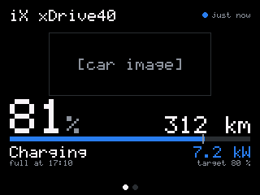
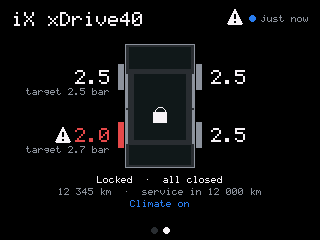
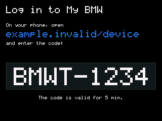

# BMW CarData

A BMW's charge and state from BMW's CarData stream, live as the car reports
it. The board connects to BMW directly.

 

1. Battery, range and charging.
2. Tyre pressures, doors and windows, lock, odometer, climate.

Swipe or `‹‹` `››` to change page. The dot at the top right is blue while
connected. A warning triangle means a low tyre, something open, or unlocked.

## Setup

### In the BMW portal

You need to be the car's primary user in My BMW, with ConnectedDrive.

1. Log in at
   [bmw.co.uk](https://www.bmw.co.uk/en-gb/mybmw/vehicle-overview) or
   [bmw.de](https://www.bmw.de/de-de/mybmw/vehicle-overview), pick the car,
   then BMW CarData.
2. Create a client ID
   ([BMW's guide](https://bmw-cardata.bmwgroup.com/customer/public/api-documentation/Id-Technical-registration_Step-1)).
   Don't press "Authenticate device".
3. Request access to the CarData API, wait a minute, then to CarData Stream.
4. In "Configure data stream", tick these and save. Not every car has all
   of them; skip the ones yours doesn't list.

```
vehicle.drivetrain.batteryManagement.header
vehicle.powertrain.electric.battery.stateOfCharge.displayed
vehicle.powertrain.electric.battery.stateOfCharge.target
vehicle.drivetrain.electricEngine.kombiRemainingElectricRange
vehicle.drivetrain.electricEngine.remainingElectricRange
vehicle.drivetrain.electricEngine.charging.status
vehicle.drivetrain.electricEngine.charging.hvStatus
vehicle.drivetrain.electricEngine.charging.method
vehicle.powertrain.electric.battery.charging.power
vehicle.drivetrain.electricEngine.charging.timeRemaining
vehicle.drivetrain.electricEngine.charging.timeToFullyCharged
vehicle.body.chargingPort.status
vehicle.powertrain.tractionBattery.charging.port.anyPosition.isPlugged
vehicle.body.trunk.isLocked
vehicle.cabin.door.row1.driver.isOpen
vehicle.cabin.door.row1.passenger.isOpen
vehicle.cabin.door.row2.driver.isOpen
vehicle.cabin.door.row2.passenger.isOpen
vehicle.cabin.window.row1.driver.status
vehicle.cabin.window.row1.passenger.status
vehicle.cabin.window.row2.driver.status
vehicle.cabin.window.row2.passenger.status
vehicle.body.trunk.isOpen
vehicle.body.hood.isOpen
vehicle.cabin.sunroof.status
vehicle.chassis.axle.row1.wheel.left.tire.pressure
vehicle.chassis.axle.row1.wheel.right.tire.pressure
vehicle.chassis.axle.row2.wheel.left.tire.pressure
vehicle.chassis.axle.row2.wheel.right.tire.pressure
vehicle.chassis.axle.row1.wheel.left.tire.pressureTarget
vehicle.chassis.axle.row1.wheel.right.tire.pressureTarget
vehicle.chassis.axle.row2.wheel.left.tire.pressureTarget
vehicle.chassis.axle.row2.wheel.right.tire.pressureTarget
vehicle.cabin.hvac.preconditioning.status.comfortState
vehicle.cabin.hvac.preconditioning.status.remainingRunningTime
vehicle.vehicle.preConditioning.activity
vehicle.vehicle.preConditioning.remainingTime
vehicle.status.serviceDistance.next
vehicle.vehicle.travelledDistance
```

The door lock (`vehicle.cabin.door.lock.status`) and
`vehicle.drivetrain.electricEngine.charging.level` aren't in the stream; the
app reads them through the API at start. The lock is hidden once newer values
arrive.

### On the board

1. Install the app from Get apps on the board (or, from its folder on a
   computer, with the studio or `luaboard install bmw_cardata`).
2. Give it your client ID from a computer, then open the app again:

   ```sh
   luaboard secrets set bmw_cardata bmw_client <client ID>
   ```

3. Open the address on the screen on your phone and enter the code.



The board renews the login itself. After 14 days without the app running,
it asks for a new code; press `○` if a code ran out. To log out, hold the
screen and press `○`.

## Development

To work on the app, clone this repository:
`luaboard install bmw_cardata --run` in it (or Install in the studio) puts
your copy of the folder on the board and starts it.

Instead of `luaboard secrets set`, put `bmw_client=<client ID>` in
`secrets.env` next to `main.lua` (copy `secrets.env.example`; git ignores
it): installing from the folder stores it with the app.

## Notes

BMW allows one stream connection per account. If something else uses it
(Home Assistant, a bridge), the board can't connect.

You need your own BMW account, and you use BMW CarData under BMW's terms.
Not affiliated with or endorsed by BMW.
