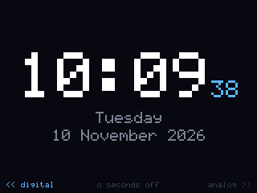
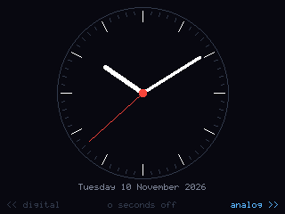

# Clock

The time and date in the device's time zone (`luaboard tz`), digital or
analog. A shows the digital face, C the analog one, and B turns the seconds
on or off. The button hints go after 5 seconds, and touching the screen or a
button brings them back.

The device gets the time from the network once it's on Wi-Fi, and after
that also from the board's clock chip.

 

## Setup

Get it from Marketplace on the board. Or, with the app's folder on a computer
(this repository, cloned), use Install in the studio or
`luaboard install clock`.

## Development

To work on the app, clone this repository: `luaboard install clock --run` in
it (or Install in the studio) puts your copy of the folder on the board and
starts it.
