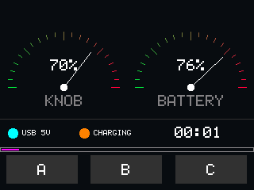

# Dashboard

Gauges for a knob on Port B and the battery, lights for USB power and
charging, and the three touch buttons lighting up when pressed. The gauges
come from `widgets.lua`, so it also shows how an app is split into modules
with `require`.

## Setup

Get it from Marketplace on the board. Or, with the app's folder on a computer
(this repository, cloned), use Install in the studio or
`luaboard install dashboard`.

## Development

To work on the app, clone this repository:
`luaboard install dashboard --run` in it (or Install in the studio) puts
your copy of the folder on the board and starts it.
