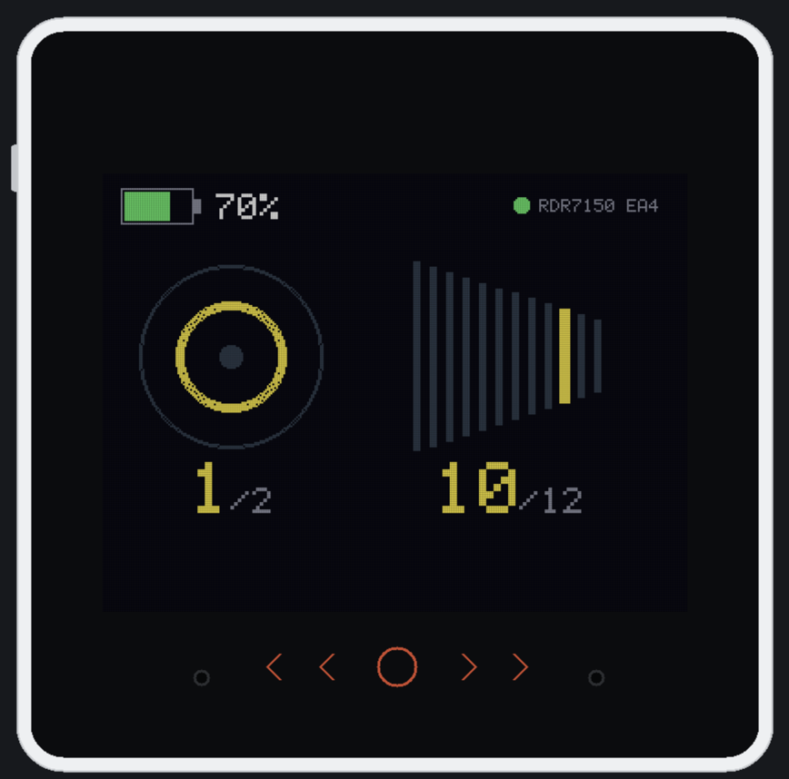

# di2

Gear position and battery level of a Shimano Di2 groupset, read from the
rear derailleur over Bluetooth LE. Made for 12-speed road Di2 (tried with a
105 Di2 RD-R7150); others may differ.



## Setup

Get it from Marketplace on the board. Or, with the app's folder on a computer
(this repository, cloned), use Install in the studio or
`luaboard install di2`.

Wake the derailleur by shifting once: it only advertises while awake. The
app connects to the first one it finds (a name starting with "RD"),
remembers it, and connects again whenever the link drops. Tap the screen to
forget it and look again. The derailleur takes one connection at a time, so
close the E-TUBE app or nRF Connect on your phone first.

## How it reads the gears

The app only reads. The battery level comes from the standard battery
service. The gear position comes from Shimano's service
`000018ef-5348-494d-414e-4f5f424c4500`: its characteristic `00002ac1-...`
notifies messages whose first byte says what they are. In those starting
with `00`, bytes 4 to 7 (counting from 1) are the front gear, the number of
front gears, the rear gear (1 is the biggest cog) and the number of rear
gears; the derailleur sends one after every shift and about once a second
besides. Others, starting `01` or `04`, are mostly `ff` bytes and are left
alone. That was worked out by watching the values; Shimano doesn't
document it.

## Development

To work on the app, clone this repository: `luaboard install di2 --run` in
it (or Install in the studio) puts your copy of the folder on the board and
starts it.

Without the bike, `sim_device.json` stands in for the derailleur in the
simulator:

```sh
BLE_DEVICE=marketplace/di2/sim_device.json cmake --build --preset default --target run
```

To shift it, send the running simulator new gear messages, for example the
big ring and the 7th cog:

```sh
luaboard sim-ctl 'ble_value=di2:00002ac1-5348-494d-414e-4f5f424c4500:00 06 03 02 02 07 0c 02'
```

Shimano and Di2 are trademarks of Shimano Inc. This app isn't made,
endorsed or supported by Shimano. It relies on what the derailleur was seen
to send, which a firmware update may change. It only reads, but use it at
your own risk.
