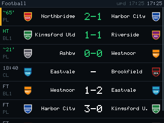

# Football

Live football scores on a desk board: the games in progress with their
score and minute, today's other games, and the latest results, for the
leagues and teams you choose. Your teams come first and are marked. Tap a
game for its detail.



## Setup

The scores come from [football-data.org](https://www.football-data.org).
It needs an account and your own key; there is a free plan.

1. Register at [football-data.org](https://www.football-data.org/client/register).
   The key (API token) comes by email and is on your account page.
2. Install the app from Marketplace on the board (or, from its folder on a
   computer, with the studio or `luaboard install football`).
3. Give it the key from a computer, then open the app again:

   ```sh
   luaboard secrets set football key <key>
   ```

To follow only some competitions, give their codes, separated by commas.
The codes are in football-data.org's
[list of competitions](https://docs.football-data.org/general/v4/lookup_tables.html),
and which ones your plan has is on their
[coverage page](https://www.football-data.org/coverage). Without `leagues`
the app shows every competition your plan has.

```sh
luaboard secrets set football leagues PL,CL
```

To put teams first, give parts of their names (any part matches, upper or
lower case):

```sh
luaboard secrets set football teams Arsenal,Bayern
```

## Usage

| Button | |
|---|---|
| `‹‹` (A) | previous game |
| `○` (B) | refresh now, or back from a game |
| `››` (C) | next game |
| tap a game | its detail, tap again to go back |
| drag | scroll |
| hold `○` | back to the menu |

The list has the games in progress first, then today's games still to
come, then the finished ones, then the other days of the window (yesterday
to tomorrow). On a day without games it shows the next ones. On the left
of each game is its minute (`~` when the app estimates it from the
kickoff), `HT`, `ET` (extra time), `PEN` (a penalty shootout, or a game
won on penalties), `FT` or the kickoff time, and under it the competition,
or the weekday for another day. The score is without the shootout; the
detail has it. The top bar says when the scores last came ("upd"), or what
went wrong: "key refused" (check the key), "check leagues" (a code your
plan doesn't have), "rate limit", "offline".

A game's detail has both crests, the score, the half-time score, the
competition and matchday, the kickoff and the venue. While it is open the
score keeps updating. Left alone for a minute, the app goes back to the top
of the list.

## Data

The app asks for the games of the window every 30 seconds while a game is
in progress, every minute from 10 minutes before a kickoff, and every 15
minutes otherwise, one request each time. The crests are fetched once per
team while the app runs. What your plan includes, how many requests it
allows and how fresh its scores are is on football-data.org's
[pricing](https://www.football-data.org/pricing) and
[policies](https://docs.football-data.org/general/v4/policies.html) pages.
When the service says to slow down, the app waits as long as it asks and
says so in the top bar.

You need your own football-data.org account, under its terms. This app
isn't made, endorsed or supported by football-data.org.

## Development

To work on the app, clone this repository: `luaboard install football
--run` in it (or Install in the studio) puts your copy of the folder on the
board and starts it.

Instead of `luaboard secrets set`, put `key` (and `leagues`, `teams`) in
`secrets.env` next to `main.lua` (a copy of `secrets.env.example`, ignored
by git): installing from the folder stores them with the app.

The parts: `games.lua` turns football-data.org's answers into the sorted
list and its labels, `web.lua` does the downloads and `pics.lua` draws the
crests (both from the news app), and `main.lua` is the screens. The
screenshot is of made-up clubs: luaboard's `pc-tool/demo/showcase/football`
serves them.
