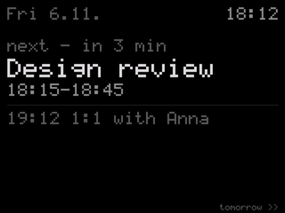
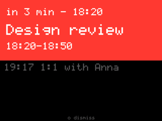

# Google Calendar

Your next meetings on a desk display. The screen stays dim: the next meeting
large with a countdown, the rest of the day small underneath. When nothing is
left today it lists tomorrow's meetings.



When one of an event's notifications comes due, it chimes and the top of
the screen pulses red until you press `○`, tap the screen, or the meeting starts.



## What alerts

- Only notification reminders count, not email reminders. An event with
  "default notifications" uses its calendar's defaults.
- Notifications at 10 and 5 minutes alert twice; dismissing the first doesn't
  silence the second.
- Declined, all-day and "free" events are left out.
- An "at time of event" notification stays up for 5 minutes after the start.
- A dismissal survives an app restart. A moved meeting alerts again.
- Alerts show only while the app runs, so make it the autostart app (hold B
  on it in the menu, then Autostart).

## Buttons

| Button | Calm view | Alert | Calendar picker |
|---|---|---|---|
| `‹‹` | today | | up |
| `○` | calendar picker (or log in again, when asked) | dismiss | tick / untick, or Done |
| `››` | tomorrow | | down |

The picker lists your calendars, with the primary one ticked at first. Done
saves the choice on the device.

## Setup

The device calls the Google Calendar API directly, read-only. You log in once
from luaboard studio.

1. Create a project at [console.cloud.google.com](https://console.cloud.google.com)
   and enable the Google Calendar API (APIs & Services > Library).
2. Google Auth Platform > Get started: an app name and your email. Audience
   Internal if your Workspace offers it, else External.
3. External only: add your Google account under Audience > Test users.
4. Clients > Create client, type Desktop app, and copy the client ID and
   secret.
5. Install the app from Marketplace on the board (or, from its folder on a
   computer, with the studio or `luaboard install gcal`).
6. Give it the client ID and secret from a computer, then open the app
   again:

   ```sh
   luaboard secrets set gcal gcal_client <Client ID>
   luaboard secrets set gcal gcal_secret <Client secret>
   ```

   The studio shows "Log in: Google Calendar" (or run `luaboard browser`).
   If Google says the app isn't verified, choose Advanced > Go to ....

An External app in Testing mode gets logged out after 7 days. The device then
asks for a login in the studio again; if nobody answers it shows *press o to
log in* and retries after 15 minutes, doubling up to 4 hours. Publishing the
app (Audience page, after filling in Branding) makes the login last.

The login is kept in the app's secret `gcal` (`luaboard secrets rm gcal gcal`
logs out), the calendar choice in `gcal_calendars` and dismissed alerts in
`gcal_dismissed`. Clear data in the app's options deletes all of them plus the
client ID and secret; set those again after it.

## Development

To work on the app, clone this repository: `luaboard install gcal --run` in
it (or Install in the studio) puts your copy of the folder on the board and
starts it.

Instead of `luaboard secrets set`, put `gcal_client=...` and
`gcal_secret=...` in `secrets.env` next to `main.lua` (copy
`secrets.env.example`; git ignores it): installing from the folder stores
them with the app.

## Files

- `main.lua`: screen, buttons, fetching every 5 minutes, alerts, picker.
- `gcal.lua`: the Calendar API client.
- `agenda.lua`: times, event filtering, what to show, which alert is due. No
  drawing or network code.

You need your own Google account and Cloud project, under Google's terms.
Not affiliated with or endorsed by Google.
