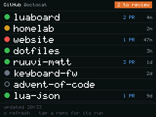

# GitHub

Your GitHub repos on a desk board. Each row is a repo: a dot for the latest
workflow run on its default branch, its open pull requests and how long ago
that run started. At the top, the pull requests waiting for your review. A
chime plays when a run fails, and another when it passes again.



| Dot | |
|---|---|
| green | passed |
| red | failed or timed out |
| yellow | queued or running |
| grey | cancelled, skipped or such |
| ring | no workflow runs |

## Setup

The device logs in as you through a GitHub App of your own. It only asks for
read access, and only to the repos you install the app on.

1. On github.com go to Settings > Developer settings > GitHub Apps > New
   GitHub App. Give it any name and homepage URL.
2. Callback URL: `http://127.0.0.1:8888/callback`. Leave "Expire user
   authorization tokens" on. Under Webhook, untick Active.
3. Permissions > Repository permissions: Actions and Pull requests
   read-only (Metadata read-only comes with them). Nothing else.
4. "Only on this account", then Create GitHub App.
5. On the app's General page copy the Client ID (not the App ID, which
   this doesn't use). Further down, under Credentials > Client secrets,
   generate a new client secret and copy it at once: GitHub shows it only
   that time. Key pairs aren't needed.
6. Install App: choose the repos the board should show (or all of them).
7. Install the app from Marketplace on the board (or, from its folder on a
   computer, with the studio or `luaboard install github`).
8. Give it the Client ID and the client secret from a computer, then open
   the app again:

   ```sh
   luaboard secrets set github github_client <Client ID>
   luaboard secrets set github github_secret <the client secret>
   ```

9. Log in when prompted, from the studio's login window or with
   `luaboard browser`.

GitHub Apps need the client secret to hand out tokens. It stays on the device
as a secret of this app. The device
keeps the login in the app secret `github` and renews it by itself (an access
token lasts 8 hours, the login 6 months). Log out with
`luaboard secrets rm github github`, or revoke it on GitHub (Settings >
Applications > Authorized GitHub Apps).

## Which repos

The ones you installed the GitHub App on, last pushed first, at most 20. To
show only some of them, in your own order, list them:

```sh
luaboard secrets set github repos "octocat/hello, octocat/widgets"
```

Repos that aren't there or that the app can't see are left out (the log says
which). Reviews waiting for you are counted in the repos the app can see.

## Usage

| Button | |
|---|---|
| `‹‹` (A) | scroll up |
| `○` (B) | fetch now, the list of repos too |
| `››` (C) | scroll down |
| swipe | scroll |
| tap a repo | its latest run: workflow, branch, result, who started it |
| hold `○` | back to the menu |

The board is fetched every 2 minutes, and the list of repos every 30. Each
fetch asks for the latest run and the open pull requests of each repo and
the review requests once: for 20 repos, about 1200 requests an hour of the
5000 GitHub allows. When GitHub says to slow down, the app waits as long as
it's told.

## Development

To work on the app, clone this repository: `luaboard install github --run`
in it (or Install in the studio) puts your copy of the folder on the board
and starts it.

Instead of `luaboard secrets set`, put `github_client`, `github_secret` (and
`repos`) in `secrets.env` next to `main.lua` (a copy of `secrets.env.example`,
ignored by git): installing from the folder stores them with the app.

## Extending it

`github.lua` is a small client for the REST API on top of the built-in
`http`, `json` and `oauth`: `gh:get(path)` returns any endpoint decoded, and
`gh:count(query)` the number of issues or pull requests matching a search,
such as `"is:issue is:open assignee:@me"`. Ask the app for more permissions
(Issues, Checks) on GitHub when a new call needs them.

You need your own GitHub account and GitHub App, under GitHub's terms.
GitHub is a trademark of GitHub, Inc. This app isn't made, endorsed or
supported by GitHub.
