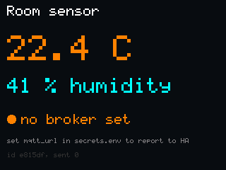

# Room Sensor

Temperature and humidity from an M5Stack ENV IV unit (SHT40) on Grove Port
A, shown on the screen and sent to Home Assistant over MQTT. With Home
Assistant's MQTT integration, the device and its two sensors appear by
themselves (MQTT discovery), and show as unavailable when the device goes
away.



## Setup

1. An MQTT broker that Home Assistant uses, e.g. the Mosquitto add-on, and a
   user for the device.
2. Install the app from Get apps on the board (or, from its folder on a
   computer, with the studio or `luaboard install ha_env`).
3. Tell it the broker from a computer, then open the app again (`mqtt_url`
   can be `mqtts://` for a broker with TLS):

   ```sh
   luaboard secrets set ha_env mqtt_url mqtt://homeassistant.local
   luaboard secrets set ha_env mqtt_user <user>
   luaboard secrets set ha_env mqtt_pass <password>
   ```

   Maybe also `luaboard autorun ha_env`, so it keeps reporting after a
   restart.

## What it sends

It measures every 30 seconds and publishes `{"temperature": 21.5,
"humidity": 45}` to `luaboard/<id>/state`. The id is random, made on the
first run and kept in `store`, so Home Assistant sees the same device after
restarts. Clearing the app's data makes a new one.

## Development

To work on the app, clone this repository: `luaboard install ha_env --run`
in it (or Install in the studio) puts your copy of the folder on the board
and starts it.

Instead of `luaboard secrets set`, put `mqtt_url`, `mqtt_user` and
`mqtt_pass` in `secrets.env` next to `main.lua` (copy `secrets.env.example`;
git ignores it): installing from the folder stores them with the app.

In the simulator, with a broker on this computer:

```sh
mosquitto -p 1883          # brew install mosquitto, apt install mosquitto, ...
cmake --build --preset default --target run     # the simulator
luaboard sim-ctl porta=env env_temp=22.5        # in another terminal: plug in the unit
```

with `luaboard secrets set ha_env mqtt_url mqtt://127.0.0.1`.
