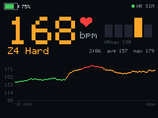
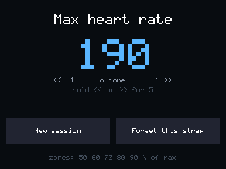

# Heart Rate

Heart rate from a Bluetooth LE chest strap, coloured by training zone, with
the last two minutes as a chart, the strap's battery and the session's time,
average and max. Tried with a Suunto chest strap.

 

## Setup

Get it from Marketplace on the board. Or, with the app's folder on a computer
(this repository, cloned), use Install in the studio or
`luaboard install heart_rate`.

It works with any sensor that has the standard Bluetooth Heart Rate service
(`180d`): chest straps such as Suunto's, Polar's, Garmin's and Wahoo's, and
watches or arm bands that can broadcast heart rate. Put the strap on (it
wakes when it feels a heartbeat). The app connects to the strongest one
advertising the service, remembers it, and connects again whenever the link
drops.

A strap may take only one connection at a time. If it doesn't show up, it's
probably connected to your watch or phone: disconnect it there, or turn off
that app's Bluetooth sensor while using this one.

## Usage

| Button | By touch | |
|---|---|---|
| `○` (B) | "New session" in the settings | a new session: time, average and max start over |
| | hold the screen | settings |
| hold `○` | the power key | back to the menu |

In the settings `‹‹` (A) and `››` (C) change the max heart rate by 1, by 5
when held, and B is done. By touch, tap or hold the left or the right of
the number for the same, and tap elsewhere when done. Tap "Forget this
strap" to look for another one.

## Zones

From the max heart rate (190 unless you set yours), as most watches count
them: zone 1 from 50 %, zone 2 from 60 %, zone 3 from 70 %, zone 4 from 80 %
and zone 5 from 90 %. The number, the bar on the right and the chart line take
the zone's colour. When the strap says it isn't touching the skin, the number
dims and the chart leaves a gap.

## What it reads

Only reads, nothing is written to the strap. The Heart Rate Measurement
characteristic (`2a37`) notifies about once a second: a flags byte, the rate
(8 or 16 bits), and optionally energy expended and RR intervals (the time
between beats, in 1/1024 s). The battery comes from the standard battery
service, if the strap has one.

The last RR interval is kept in `HR.rr` (milliseconds) but not shown. Heart
rate variability (for example RMSSD over the last minute) would be a small
addition in `on_measurement()`.

## Development

To work on the app, clone this repository:
`luaboard install heart_rate --run` in it (or Install in the studio) puts
your copy of the folder on the board and starts it.

Without a strap, `sim_device.json` stands in for one in the simulator:

```sh
BLE_DEVICE=marketplace/heart_rate/sim_device.json cmake --build --preset default --target run   # in luaboard
```

Send it a new reading, for example 150 bpm (flags `16`: skin contact, an RR
interval of 1024/1024 s):

```sh
luaboard sim-ctl 'ble_notify=hr:2a37:16 96 00 04'
```

On macOS the simulator also reaches the Mac's own Bluetooth, so a real strap
nearby works there too.

Suunto, Polar, Garmin and Wahoo are trademarks of their owners. This app
isn't made, endorsed or supported by any of them.
