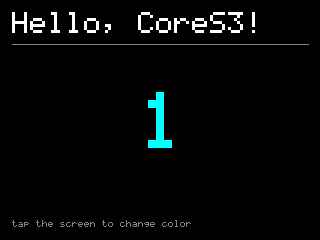

# Hello

The smallest useful app: a greeting and a counter. Tap the screen to change
the color. A good place to start your own.

## Setup

Get it from Get apps on the board. Or, with the app's folder on a computer
(this repository, cloned), use Install in the studio or
`luaboard install hello`.

## Development

To work on the app, clone this repository: `luaboard install hello --run` in
it (or Install in the studio) puts your copy of the folder on the board and
starts it.
