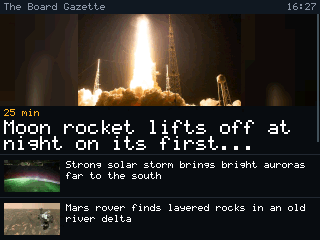

# News

The top stories of a news feed you choose, with pictures. The feed's first
story is big at the top, the next ones are listed under it. Tap a story for
its summary. The app refreshes the feed by itself every 5 minutes, so it can
be left running on a desk.



## Setup

The app shows any RSS or Atom feed. Most news sites have one: look for an
RSS link or icon on the site, or try its address with `/rss` or `/feed` at
the end. The feed's address usually ends in `.xml`, `/rss` or `/feed`.

1. Install the app from Marketplace on the board (or, from its folder on a
   computer, with the studio or `luaboard install news`).
2. Give it the feed's address from a computer, then open the app again:

   ```sh
   luaboard secrets set news feed <url>
   ```

## Usage

| Button | By touch | |
|---|---|---|
| `‹‹` (A) | drag | previous story |
| `○` (B) | pull the list down at its top | refresh now |
| `››` (C) | drag | next story |
| | tap a story | its summary, tap again (or `○`) to go back |
| hold `○` | the power key | back to the menu |

In a summary, `‹‹` and `››`, or a swipe to the right and to the left, go to
the previous and next story's summary.
Left alone for a minute, the app goes back to the top of the list. A story
that came after the app started shows NEW for an hour: an orange tag on the
first story, an orange bar on the others.

## Feeds

The app shows the feed's first 20 stories, in the feed's own order, so the
story at the top is the one the site puts first. Each story's picture comes
from the feed (`media:content`, `media:thumbnail` or an image `enclosure`).
The first story and the summaries show the whole picture, with a dimmed
copy of it filling the sides; the rows' small pictures are cropped.
The board decodes baseline JPEG and PNG pictures up to 256 KB. Some sites
send progressive JPEGs or bigger files, which it can't use, and some feeds
have no pictures at all: those stories get a colored panel with the feed's
name instead. A feed itself can be up to 256 KB.

The feed is fetched every 5 minutes while the app runs, which is as often as
many sites ask feed readers to. If a refresh fails, the stories already
shown stay, the reason shows in the top bar ("offline", "timed out",
"HTTP 503" and the like), and the app tries again in a minute. Pictures that
didn't load while offline come after the next good refresh.

A feed's stories and pictures belong to the site that publishes it, under
its terms. Feeds are generally offered for personal reading, which is what
the app is for.

## Development

To work on the app, clone this repository: `luaboard install news --run`
in it (or Install in the studio) puts your copy of the folder on the board
and starts it.

Instead of `luaboard secrets set`, put `feed` in `secrets.env` next to
`main.lua` (a copy of `secrets.env.example`, ignored by git): installing
from the folder stores it with the app.

The parts: `feed.lua` reads RSS and Atom with string patterns, `web.lua`
does the downloads (relative addresses, short notes for errors), `pics.lua` decodes a picture, crops it and resizes it to
its box, `wrap.lua` breaks headlines into lines, and `main.lua` is the
screens. The screenshot is of a made-up feed: luaboard's
`pc-tool/demo/showcase/news` serves it, with pictures from NASA.
