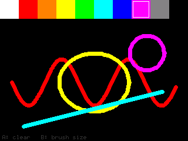

# Paint

Finger painting. Pick a color from the row at the top and draw. A clears the
canvas and B switches to a big brush.

## Setup

Get it from Get apps on the board. Or, with the app's folder on a computer
(this repository, cloned), use Install in the studio or
`luaboard install paint`.

## Development

To work on the app, clone this repository: `luaboard install paint --run` in
it (or Install in the studio) puts your copy of the folder on the board and
starts it.
