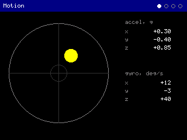

# Sensors

What the board's own sensors measure, a page each. Swipe to the side for the
next page (or the buttons A and C).

- Motion: a level. The bubble goes where down is, with the acceleration and
  the rotation in numbers next to it.
- Compass: the magnetic field, and a needle to the north once the board has
  been turned around once, held flat. A tap starts that over.
- Light: how light it is, in lux, and how near something is to the sensor
  above the screen.
- Camera: the camera's live picture. A tap on it mirrors it, and back. The
  round button saves a photo on the SD card (`photo_1.jpg`, `photo_2.jpg`
  and so on, 320x240). Without a card the page says so in red, and the
  button is grey. The card has to be FAT32.

CoreS3 and CoreS3 Lite have these sensors. A CoreS3 SE has none, and every
page says so there.

On a CoreS3 Lite the compass page says the field is too strong while the
back cover is on: the cover has magnets in it, right behind the compass.

## Setup

Get it from Marketplace on the board. Or, with the app's folder on a computer
(this repository, cloned), use Install in the studio or
`luaboard install sensors`.

## Development

To work on the app, clone this repository: `luaboard install sensors --run`
in it (or Install in the studio) puts your copy of the folder on the board
and starts it.
