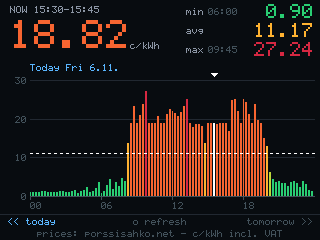

# Spot Price Finland

Finland's electricity spot price: the price now, the day's min, average and
max, and a chart of the day's 15-minute prices, today and (from about 14:00)
tomorrow.

## Data

Prices come from the free API of [porssisahko.net](https://porssisahko.net)
([API docs](https://porssisahko.net/api)). Thanks to its maintainer for
keeping it open.

- Nord Pool day-ahead price for the Finland (FI) price area, in c/kWh
  including Finnish VAT (25.5 %). Your contract's margin and grid fees come on
  top.
- Finland only: other Nordic and Baltic price areas have their own prices.
- 96 quarter-hour prices a day.
- Tomorrow's prices are published around 14:00 Finnish time.

The API allows 30 requests per 10 seconds per IP and asks for at most one
fetch a minute. The app fetches the latest 48 hours once an hour, and every 10
minutes after 14:00 until tomorrow's prices are out. After 14:00 that window
starts at 01:00 Finnish time, so after a fetch it asks `price.json` for the
missing slots of today, up to 8 at a time.

## Setup

Get it from Get apps on the board. Or, with the app's folder on a computer
(this repository, cloned), use Install in the studio or
`luaboard install spot_price_fi`.

## Usage

| Button | |
|---|---|
| `‹‹` (A) | today |
| `○` (B) | fetch now |
| `››` (C) | tomorrow |
| tap a bar | that quarter hour's price, for 5 s |
| hold `○` | back to the menu |

Bars are blue for zero or negative prices, green under 5 c, then yellow,
orange and red, deep red from 25 c/kWh. The dashed line is the day's average
and the white bar (with the marker above it) is now.

## Time

The app uses the device clock (`sys.time()`), or the `Date` header of the API
reply until the clock is set. Prices follow Finnish days, so the app computes
Finnish time itself (summer time from the last Sunday of March to the last
Sunday of October), whatever the device's time zone.

## Development

To work on the app, clone this repository:
`luaboard install spot_price_fi --run` in it (or Install in the studio) puts
your copy of the folder on the board and starts it.
