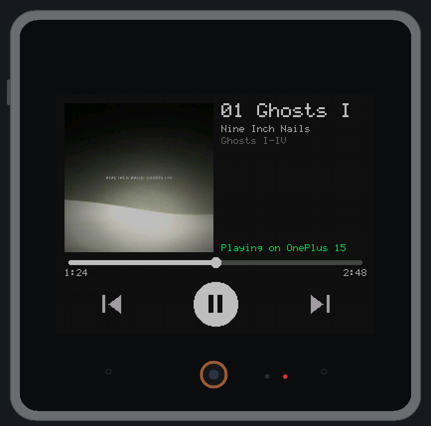

# Spotify

Now playing with cover art and previous / play-pause / next. The device calls
the Spotify Web API directly over HTTPS. Playback control needs Premium.



The screenshot shows the cover of Ghosts I–IV by Nine Inch Nails, released
under [CC BY-NC-SA 3.0](https://creativecommons.org/licenses/by-nc-sa/3.0/).
`cores3.png` is shared under that license, not the app's MIT license.

## Setup

1. In the [Spotify developer dashboard](https://developer.spotify.com/dashboard),
   add `http://127.0.0.1:8888/callback` as a redirect URI.
2. Install the app from Marketplace on the board (or, from its folder on a
   computer, with the studio or `luaboard install spotify`).
3. Give it your app's Client ID from a computer, then open the app again
   (no client secret is needed, PKCE):

   ```sh
   luaboard secrets set spotify spotify_client <Client ID>
   ```

4. Log in when prompted, from the studio's login window or with
   `luaboard browser`.

The device keeps the login in the app secret `spotify` and refreshes it. Log
out with `luaboard secrets rm spotify spotify`.

## Development

To work on the app, clone this repository: `luaboard install spotify --run`
in it (or Install in the studio) puts your copy of the folder on the board
and starts it.

Instead of `luaboard secrets set`, put `spotify_client=<Client ID>` in
`secrets.env` next to `main.lua` (a copy of `secrets.env.example`, ignored by
git): installing from the folder stores it with the app.

## spotify.lua

The API client is its own module, `spotify.lua`, on top of `http`, `json` and
`oauth`. `local sp = require("spotify").new{ client_id = "...", on_login = fn }`,
then inside a task: `sp:player()` -> `{ playing, title, artist, album, progress,
duration, device, cover, id }` (`false` if nothing is playing, `nil, err` on
errors), `sp:play()`, `sp:pause()`, `sp:next()`, `sp:previous()`,
`sp:cover(url)` -> JPEG for `disp.jpeg`, `sp:logout()`.
Errors say what's wrong: Premium needed (403), no active device (404),
rate limited (429, waits as asked).

You need your own Spotify account and developer app, under Spotify's terms.
Not affiliated with or endorsed by Spotify.
