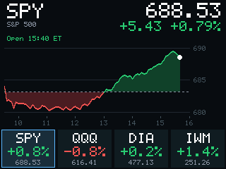

# Stocks

US stock and ETF prices on a desk board: the price now, the change from the
previous close and the day's chart, with a tile for each symbol. By default
the four ETFs that follow the big indexes: SPY (S&P 500), QQQ (Nasdaq 100),
DIA (Dow Jones) and IWM (Russell 2000).



## Setup

The prices come from [Alpaca](https://alpaca.markets)'s market data API.
Its free plan needs an account and your own keys, no money or trading.

1. Sign up at alpaca.markets. A paper trading account is enough.
2. On the dashboard's Home page, further down on the right, the API Keys
   box: Generate New Keys, and copy the key and the secret. The secret is
   shown only once. (The box's Endpoint is for trading; the app doesn't
   use it.)
3. Install the app from Get apps on the board (or, from its folder on a
   computer, with the studio or `luaboard install stocks`).
4. Give it the keys from a computer, then open the app again:

   ```sh
   luaboard secrets set stocks alpaca_key <key>
   luaboard secrets set stocks alpaca_secret <secret>
   ```

To show other symbols, at most four, set `symbols` the same way:

```sh
luaboard secrets set stocks symbols SPY,QQQ,NVDA,AAPL
```

## Usage

| Button | |
|---|---|
| `‹‹` (A) | previous symbol |
| `○` (B) | fetch now |
| `››` (C) | next symbol |
| tap a tile | that symbol |
| hold `○` | back to the menu |

The chart is the regular session, 9:30 to 16:00 New York time. The dashed
line is the previous close: the area above it is green, below it red. While
the market is open the white dot is the latest trade. Once it has closed,
the price at the top is the closing price, and the latest after-hours trade
is under it. Before the opening
the chart is the last session, without the previous close, and the price at
the top is the latest pre-market trade. The screen stays on while the app
runs.

## Data

Alpaca's free plan has real-time prices from one exchange, IEX, not the
consolidated prices of all US exchanges. For SPY and other heavily traded
symbols the two stay close; a thinly traded stock can go minutes without an
IEX trade. The plan allows 200 requests a minute.

The app asks for the latest prices every 15 seconds while the market is open
and the day's 5-minute bars every 5 minutes, a request each for all symbols.
While the market is closed it asks every 30 minutes, and again right at the
opening. Holidays aren't known ahead of time: on one, it asks every 5
minutes during the usual hours.

You need your own Alpaca account, under Alpaca's terms. They allow the data
for personal and non-commercial use only: keep the board to yourself, and
don't use it for a business.

## Time

The app uses the device clock (`sys.time()`), or the `Date` header of the API
reply until the clock is set. The market keeps New York time, so the app
computes it itself (summer time from the second Sunday of March to the first
Sunday of November), whatever the device's time zone.

This app isn't made, endorsed or supported by Alpaca. It isn't
investment advice.

## Development

To work on the app, clone this repository: `luaboard install stocks --run`
in it (or Install in the studio) puts your copy of the folder on the board
and starts it.

Instead of `luaboard secrets set`, put `alpaca_key`, `alpaca_secret` (and
`symbols`) in `secrets.env` next to `main.lua` (copy `secrets.env.example`;
git ignores it): installing from the folder stores them with the app.
