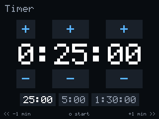
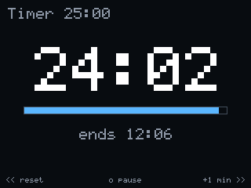
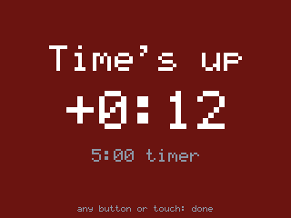

# Timer

A countdown timer that beeps when it's up. It remembers the time you set and
the last ones you started, and a running or paused timer is still there
when you come back to the app or restart the board.

  

## Setup

Get it from Marketplace on the board. Or, with the app's folder on a computer
(this repository, cloned), use Install in the studio or
`luaboard install timer`.

## Setting it

Tap `+` or `-` above or below the hours, minutes or seconds. Hold one to
keep going. Each field wraps around on its own (59 seconds up is 0, the
minutes stay). The recent times are below: tap one to set it. Up to
9:59:59.

| Button | |
|---|---|
| `‹‹` (A) | a minute less, 5 when held |
| `○` (B) | start |
| `››` (C) | a minute more, 5 when held |
| hold `○` | back to the menu |

## Running

The time left, a bar, and the clock time it ends. The screen stays on
while the board is on USB power.

| Button | |
|---|---|
| `‹‹` (A) | reset |
| `○` (B) or a tap | pause, resume |
| `››` (C) | a minute more |

When it's up it beeps and the screen flashes for a minute, and it counts
the time since. Any button or touch says you've seen it: back to the set
screen, at the time it was started with, ready to start again with B.

## What it keeps

In the app's `store`: the time set (`last`), the last four started
(`recent`) and the running or paused timer (`run`). They survive leaving
the app, reboots and firmware updates. *Clear data* in the app's options
(hold B on it in the menu) forgets them.

A paused timer is kept as the time left. A running one is kept as the clock
time it ends, so it needs the clock (`sys.time()`): from the network, or
after a reset from the board's clock chip. If the time isn't known when the
app starts, it waits for it. Coming back after it ended shows how long ago
that was. It beeps only if that's less than a minute.

The app can't ring while another app runs, or while the board has been
turned off by hand.

## On battery

The timer saves the battery while it waits. The screen follows the
device's Screen off setting, and when the time is up the alarm turns it
back on. Once the device is asleep with a minute or more left, the timer
turns the device off altogether and has it turn itself on again a few
seconds before the end (a minute or two before, for waits over four
minutes), where it picks up the kept timer and rings on time. That takes
the clock, as keeping a running timer does. Pressing the power key
meanwhile turns the device on with the timer still running.

With nothing running, the device's Turn off after setting decides when a
forgotten device turns off. While a timer runs or rings, the app holds
that off.

## Development

To work on the app, clone this repository: `luaboard install timer --run` in
it (or Install in the studio) puts your copy of the folder on the board and
starts it.
