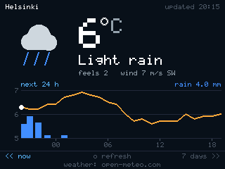
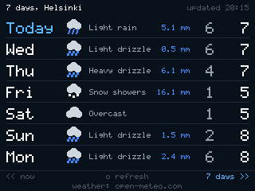

# Weather

The weather now and the next 24 hours for one place: temperature, feels-like
and wind, with a chart of the temperature and rain. C shows the next 7 days.
No account or API key needed.

 

## Setup

Get it from Marketplace on the board. Or, with the app's folder on a computer
(this repository, cloned), use Install in the studio or
`luaboard install weather`.

It shows Helsinki until you set your place from a computer, then open the
app again (more in [The place](#the-place)):

```sh
luaboard secrets set weather place Tampere
```

## Usage

| Button | |
|---|---|
| `‹‹` (A) | now and the next 24 hours |
| `○` (B) | fetch now |
| `››` (C) | the next 7 days |
| hold `○` | back to the menu |

The screen stays on while the app runs. In the chart the orange line is the
temperature, the white dot is now, and the blue bars are the rain of each
hour.

## The place

Set from a computer, then open the app again. It isn't secret, but that's
how an app gets its own settings onto the device.

- `luaboard secrets set weather place Tampere`: looked up by name with
  Open-Meteo's geocoding, once. The result is kept on the device until the
  name changes.
- `lat` and `lon` (`61.4991` and `23.7871`): exactly there. `place` is then
  only the label at the top.
- Neither: Helsinki.

## Data

Forecasts come from [Open-Meteo](https://open-meteo.com), whose free API needs
no key and is meant for non-commercial use. The data is under
[CC BY 4.0](https://creativecommons.org/licenses/by/4.0/), so the screen
credits it. The app asks for it every 15 minutes, as often as Open-Meteo
updates the current values, and every minute after a failed fetch.

Temperatures are in °C, wind in m/s, rain in mm. Times are the place's own,
from Open-Meteo's reply, whatever the device's time zone.

Extending it: the forecast URL in `fetch()` asks for the
[variables](https://open-meteo.com/en/docs) the screens use. Add more there
(UV index, sunrise, snow depth) and draw them in `draw_now()` or `draw_days()`.

## Development

To work on the app, clone this repository: `luaboard install weather --run`
in it (or Install in the studio) puts your copy of the folder on the board
and starts it.

Instead of `luaboard secrets set`, put `place=...` (or `lat` and `lon`) in
`secrets.env` next to `main.lua` (a copy of `secrets.env.example`, ignored by
git): installing from the folder stores them with the app.